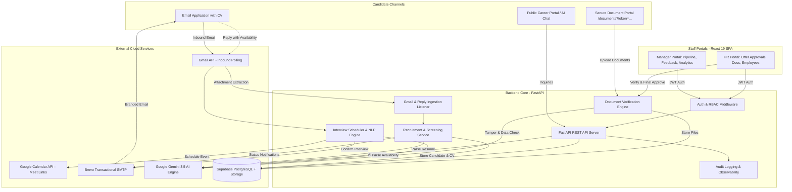
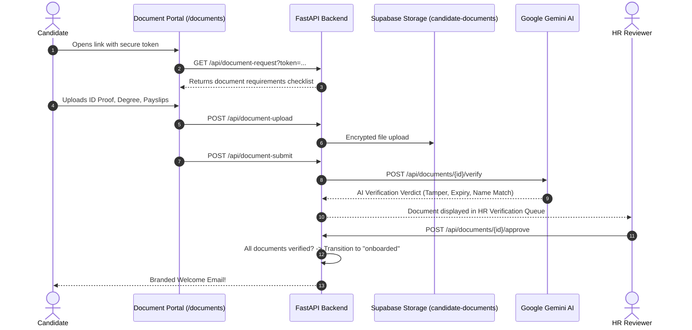
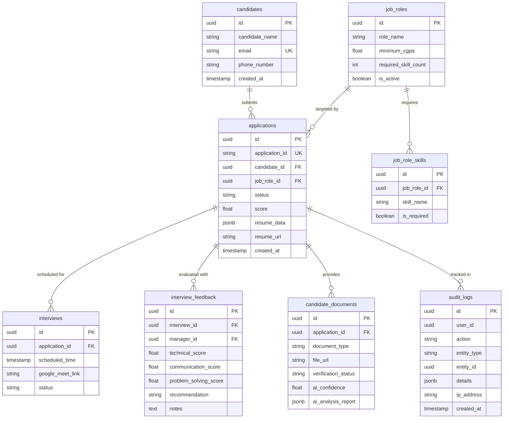

# VTAB Square — AI Recruitment System
# Comprehensive System Essentials & Implementation Guide

**Document Version:** 1.0.0  
**Date:** September 2026  
**Status:** Verified & Operational in Production  
**Target Audience:** Management, Technical Leads, HR Stakeholders, System Administrators  

---

## Executive Overview

The **VTAB Square AI Recruitment System** is an enterprise-grade autonomous recruitment and candidate onboarding platform. It replaces manual resume screening, calendar scheduling friction, disconnected document collection, and delayed email communications with an intelligent, end-to-end automated workflow powered by Google Gemini AI, Gmail API, Google Calendar API, Brevo SMTP, and Supabase PostgreSQL.

```
┌────────────────────────────────────────────────────────────────────────────────────────┐
│                              AUTONOMOUS RECRUITMENT PIPELINE                           │
├─────────────────┬──────────────────┬──────────────────┬─────────────────┬──────────────┤
│ 1. INGESTION    │ 2. SCREENING     │ 3. INTERVIEWS    │ 4. EVALUATION   │ 5. ONBOARDING│
│ Gmail Listener  │ Gemini AI Parser │ 2-Way Reply NLP  │ Manager Portal  │ Token Portal │
│ Attachments     │ Role & CGPA Match│ Google Calendar  │ Multi-Skill AI  │ AI Doc Verify│
│ Cloud Storage   │ Auto-Decision    │ Google Meet Sync │ HR Offer Review │ Employee DB  │
└─────────────────┴──────────────────┴──────────────────┴─────────────────┴──────────────┘
```

---

## Summary of Essentials Implemented

| Category | Key Capabilities Implemented | Primary Tech Stack | Status |
| :--- | :--- | :--- | :--- |
| **1. Resume Ingestion** | Background Gmail listener, attachment extraction (.pdf/.docx), anti-duplicate tracking, smart re-application support | Gmail API, `pdfminer.six`, `python-docx`, Supabase Storage | **Operational** |
| **2. AI Screening** | Structured JSON CV extraction, minimum CGPA & required skills matching, dynamic model fallback (`gemini-3.5-flash`/`gemini-3.5-flash-lite`) | Google Gemini 3.5, Supabase PostgreSQL, Brevo SMTP | **Operational** |
| **3. Interview Scheduling** | NLP candidate reply parsing, calendar slot booking, automated Google Meet video links, sync calendar invites | Google Calendar API, Gemini NLP, Brevo SMTP | **Operational** |
| **4. Manager Portal** | RBAC login, pipeline queue, resume preview drawer, 4-dimension scorecard, AI feedback synthesis, hiring recommendations, analytics | React 19, FastAPI, Supabase Auth JWT, Gemini AI | **Operational** |
| **5. HR Portal** | Offer approval queue, tokenized document link generation, employee directory, immutable system audit logs | React 19, FastAPI, Supabase DB | **Operational** |
| **6. Document Verification**| Zero-friction tokenized candidate portal (`/documents?token=...`), Gemini AI document tamper & validity inspection, HR approval workflow | React 19, Supabase Storage, Google Gemini AI | **Operational** |
| **7. Public AI Assistant** | Floating conversational candidate assistant, recruitment guardrails, prompt injection protection | React 19, FastAPI, Google Gemini 3.5 | **Operational** |
| **8. Security & Auth** | Supabase Auth JWT, self-service password reset (single/double hash URL parsing), zero-secrets git policy, API error sanitization | Supabase Auth, Brevo SMTP, Pydantic | **Operational** |
| **9. Resilience & Reliability**| Tenacity exponential backoff retries on all 3rd-party APIs, thread-safe deduplication, `/health` readiness check | Tenacity, Uvicorn, Render Web Service | **Operational** |
| **10. QA & Verification** | 47/47 frontend UI tests passing, 344/344 backend integration tests passing, live end-to-end verified | Vitest, Pytest, Github Actions CI | **100% Passing** |

---

## 1. System Architecture & Topology

The system uses a decoupled, modern cloud architecture designed for high availability and low latency:



### Component Details
- **Frontend SPA (Vite + React 19):** Modern, responsive interface with role-based routing (Manager, HR, Document Portal, Candidate Assistant, Password Reset). Built and deployed on Render.
- **Backend API (FastAPI + Python 3.12):** Asynchronous REST service running on Render (`https://ai-recruitment-system-1-f6yw.onrender.com`). Exposes 20+ secure endpoints with automatic OpenAPI documentation.
- **Database & Storage (Supabase):** PostgreSQL relational database with foreign key integrity, Row-Level Security (RLS), and S3-compatible encrypted buckets (`resumes`, `candidate-documents`).
- **AI Engine (Google Gemini 3.5):** Powers resume parsing, reply availability extraction, interview score evaluation, candidate chat, and document verification.
- **Email Infrastructure (Brevo SMTP & Gmail API):** Dual-layer email architecture—Gmail API handles inbound application reading and reply listening; Brevo SMTP handles reliable outbound transactional delivery.
- **Calendar & Video (Google Calendar API):** Automates slot booking and generates live Google Meet video links.

---

## 2. Detailed Breakdown of Implemented Essentials

### Essential 1: Autonomous Inbound Email & Resume Ingestion
*Source Code: [`Backend/email_recruitment_pipeline.py`](file:///c:/Users/moham/OneDrive/Documents/AI-Recruitment-System-main/AI-Recruitment-System-main/Backend/email_recruitment_pipeline.py), [`Backend/gmail_reader.py`](file:///c:/Users/moham/OneDrive/Documents/AI-Recruitment-System-main/AI-Recruitment-System-main/Backend/gmail_reader.py), [`Backend/recruitment_service.py`](file:///c:/Users/moham/OneDrive/Documents/AI-Recruitment-System-main/AI-Recruitment-System-main/Backend/recruitment_service.py)*

1. **Automated Inbox Polling:** A background worker polls the dedicated inbox (`vitabsquare@gmail.com`) every 30 seconds for unread emails containing CV attachments.
2. **Multi-Format Extraction:** Automatically extracts text from `.pdf` (via `pdfminer.six`) and `.docx` (via `python-docx`) files.
3. **Cloud Document Archival:** Uploads original resumes to the Supabase `resumes` storage bucket with unique timestamps.
4. **Thread-Safe Message Deduplication:** Tracks ingested messages in `processed_gmail_messages` to ensure an email is never processed twice, even during rapid polling cycles.
5. **Smart Re-Application Handling:**
   - **Active Candidates:** If a candidate with an active application (`shortlisted`, `interview_scheduled`, etc.) submits another email, the system retains their current state and sends a courteous status update.
   - **Previously Rejected Candidates:** If a candidate previously marked `rejected` submits an updated resume, the pipeline re-opens evaluation with a fresh application cycle and scorecard.

---

### Essential 2: AI Screening, Scoring & Job Matching Engine
*Source Code: [`Backend/ai_analyzer.py`](file:///c:/Users/moham/OneDrive/Documents/AI-Recruitment-System-main/AI-Recruitment-System-main/Backend/ai_analyzer.py), [`Backend/recruitment_service.py`](file:///c:/Users/moham/OneDrive/Documents/AI-Recruitment-System-main/AI-Recruitment-System-main/Backend/recruitment_service.py)*

1. **Structured JSON Extraction:** Sends raw resume text to Gemini AI using a strict Pydantic JSON schema. Extracts:
   - Full Name, Email, Phone
   - Highest Education & Specialization
   - Academic Score (CGPA / Percentage normalized to 10-point scale)
   - Technical Skill List
   - Years of Work Experience
   - Major Projects & Certifications
2. **Dynamic AI Model Fallback:**
   - Primary: `gemini-3.5-flash`
   - Secondary: `gemini-3.5-flash-lite`
   - *Advantage:* If Google retires or rate-limits a model version (such as the deprecated `gemini-2.5-flash`), the backend automatically reroutes requests without throwing 404/500 errors.
3. **Multi-Parameter Role Matching:**
   - Compares candidate data against active openings in `job_roles`.
   - Checks two strict gates:
     1. **CGPA Threshold:** Candidate CGPA $\ge$ Role Minimum CGPA.
     2. **Skill Match Threshold:** Matched Skills $\ge$ Role Required Skill Count.
4. **Automated Decision & Email Notification:**
   - **Shortlisted:** Application state moves to `shortlisted`. Brevo immediately dispatches a branded invitation email requesting interview availability.
   - **Rejected:** Application state moves to `rejected`. Brevo dispatches a professional rejection letter.

---

### Essential 3: Two-Way Interview Scheduling & Google Calendar Integration
*Source Code: [`Backend/reply_pipeline.py`](file:///c:/Users/moham/OneDrive/Documents/AI-Recruitment-System-main/AI-Recruitment-System-main/Backend/reply_pipeline.py), [`Backend/interview_scheduler.py`](file:///c:/Users/moham/OneDrive/Documents/AI-Recruitment-System-main/AI-Recruitment-System-main/Backend/interview_scheduler.py)*

1. **Reply Monitoring:** The system listens for incoming replies to interview invitation emails.
2. **NLP Availability Parsing:** Gemini AI extracts natural-language availability statements (e.g., *"I can join Friday at 2:00 PM or Monday morning"*) and resolves them into structured UTC `datetime` objects.
3. **Calendar Booking & Google Meet Link:**
   - Invokes Google Calendar API via OAuth2 credentials.
   - Creates a 45-minute video interview session.
   - Automatically provisions a Google Meet conference link (`meet.google.com/xxx-xxxx-xxx`).
   - Invites both the candidate and hiring manager.
4. **Confirmation & DB Sync:** Dispatches confirmation emails containing the calendar invite, updates `interviews` table, and sets application status to `interview_scheduled`.

---

### Essential 4: Manager Portal & Decision Workflows
*Source Code: [`Frontend/src/App.jsx`](file:///c:/Users/moham/OneDrive/Documents/AI-Recruitment-System-main/AI-Recruitment-System-main/Frontend/src/App.jsx), [`Backend/app.py`](file:///c:/Users/moham/OneDrive/Documents/AI-Recruitment-System-main/AI-Recruitment-System-main/Backend/app.py)*

1. **Role-Gated Access:** Protected by Supabase Auth JWT; restricted to users with the `manager` role.
2. **Interactive Candidate Queue:**
   - Real-time pipeline view with filtering by Status (`All`, `Shortlisted`, `Interview Scheduled`, `Interview Completed`, `Rejected`, `Hired`) and Job Role.
   - Instant search across candidate names, emails, and skill keywords.
3. **Candidate Deep-Dive Drawer:**
   - Direct resume PDF preview embedded in the portal.
   - Visual AI Match Breakdown: itemized matched skills vs. missing skills, CGPA verification badge, and work history.
4. **Standardized 4-Dimension Interview Evaluation:**
   - Form capturing numeric scores (1–5) and qualitative notes across:
     - *Technical Proficiency*
     - *Communication & Articulation*
     - *Problem-Solving Ability*
     - *Cultural & Value Alignment*
   - **AI Synthesis:** Gemini computes a weighted score and provides an objective hiring summary.
   - **Manager Actions:** Manager selects recommendation (`Hire`, `Reject`, `Second Round`).
   - Selecting `Hire` forwards the candidate to HR Offer Approvals; selecting `Reject` sends a polite decision email automatically.
5. **Manager Analytics Dashboard:** Real-time graphs showing total pipeline count, shortlist percentage, interview pass rate, and skill gap trends.

---

### Essential 5: HR Portal, Offer Approvals & Employee Management
*Source Code: [`Frontend/src/App.jsx`](file:///c:/Users/moham/OneDrive/Documents/AI-Recruitment-System-main/AI-Recruitment-System-main/Frontend/src/App.jsx), [`Backend/app.py`](file:///c:/Users/moham/OneDrive/Documents/AI-Recruitment-System-main/AI-Recruitment-System-main/Backend/app.py)*

1. **Offer Approvals Queue:** Dedicated dashboard for `hr` users displaying manager-recommended candidates. HR reviews salary, role, and manager notes before making an offer.
2. **Automated Onboarding Trigger:**
   - Approving an offer generates a cryptographically secure, single-use token (`secrets.token_urlsafe(32)`).
   - Transitions status to `documents_pending`.
   - Sends a personalized onboarding email to the candidate containing their private document upload link (`/documents?token=...`).
3. **Employee Directory:** Searchable repository of all hired personnel tracking department, designation, joining date, and verified document links.
4. **Immutable Audit Trail:** Real-time interface querying `audit_logs` to inspect every privileged action (user ID, action, entity, timestamp, client IP).

---

### Essential 6: Candidate Document Portal & AI Authenticity Inspection
*Source Code: [`Backend/app.py`](file:///c:/Users/moham/OneDrive/Documents/AI-Recruitment-System-main/AI-Recruitment-System-main/Backend/app.py), [`Frontend/src/App.jsx`](file:///c:/Users/moham/OneDrive/Documents/AI-Recruitment-System-main/AI-Recruitment-System-main/Frontend/src/App.jsx)*



1. **Tokenized External Portal:** Candidates access a dedicated upload screen via `/documents?token=...` without requiring user registration.
2. **Checklist & File Validation:** Enforces uploads for:
   - Government Photo ID (Aadhaar / Passport / Driving License)
   - Degree Certificate or Final Marksheet
   - Relieving Letter or Last 3 Months' Payslips
   - Supports PDF, PNG, JPG up to 10MB.
3. **AI Authenticity Inspection:** When documents are submitted, Gemini AI performs automated forensics:
   - **Document Type Check:** Validates that the uploaded document matches the requested type.
   - **Name Match:** Compares the name on the document against candidate application records.
   - **Expiry Check:** Ensures ID and credentials are valid and unexpired.
   - **Tamper Detection:** Analyzes visual and typographical artifacts for signs of alteration.
4. **HR Verification & Final Sign-Off:**
   - HR reviews document previews side-by-side with the AI confidence score and findings.
   - Upon HR approving all required documents, the candidate status changes to `onboarded` and their record is added to the Employee Directory.

---

### Essential 7: Candidate Public AI Career Assistant
*Source Code: [`Frontend/src/App.jsx`](file:///c:/Users/moham/OneDrive/Documents/AI-Recruitment-System-main/AI-Recruitment-System-main/Frontend/src/App.jsx), [`Backend/app.py`](file:///c:/Users/moham/OneDrive/Documents/AI-Recruitment-System-main/AI-Recruitment-System-main/Backend/app.py)*

1. **Floating UI Chat Widget:** Accessible on the public career homepage for prospective applicants.
2. **Context-Aware Assistance:** Answers candidate questions regarding open roles, company culture, required qualifications, interview formats, and application status.
3. **Prompt Guardrails & Anti-Injection:** Rejects unrelated questions (general trivia, code execution, non-recruitment topics) and blocks prompt injection attempts.
4. **High Availability Fallback:** Leverages `_call_gemini_with_fallback()` to toggle between `gemini-3.5-flash` and `gemini-3.5-flash-lite`.

---

### Essential 8: Enterprise Security, Authentication & Password Reset
*Source Code: [`Backend/app.py`](file:///c:/Users/moham/OneDrive/Documents/AI-Recruitment-System-main/AI-Recruitment-System-main/Backend/app.py), [`Frontend/src/App.jsx`](file:///c:/Users/moham/OneDrive/Documents/AI-Recruitment-System-main/AI-Recruitment-System-main/Frontend/src/App.jsx)*

1. **Role-Based Access Control (RBAC):** Every API endpoint is protected by `require_role(["manager"])` or `require_role(["hr"])` dependencies validating Supabase JWT tokens.
2. **Robust Self-Service Password Reset:**
   - Fully resolved URL hash parsing: supports single-hash (`/#access_token=...`), double-hash (`/#type=recovery#access_token=...`), and query parameters.
   - Removed dummy `"active"` fallback token that previously triggered false 400 Bad Request errors.
   - Delivery configured through Brevo SMTP, eliminating incorrect `localhost:5173` redirect issues.
3. **Automated Secret Scanning:** CI/CD pipeline scans for `.env`, `credentials.json`, `token.json`, and API keys to guarantee no secrets enter source control.
4. **Data Sanitization:** Stack traces, internal database schema definitions, and sensitive tokens are stripped from error responses before reaching the client.

---

### Essential 9: Resilience, Fault Tolerance & Observability
*Source Code: [`Backend/app.py`](file:///c:/Users/moham/OneDrive/Documents/AI-Recruitment-System-main/AI-Recruitment-System-main/Backend/app.py), [`Backend/interview_scheduler.py`](file:///c:/Users/moham/OneDrive/Documents/AI-Recruitment-System-main/AI-Recruitment-System-main/Backend/interview_scheduler.py)*

1. **Exponential Backoff Retries:** All outbound requests to Google Gemini, Google Calendar, Brevo SMTP, and Supabase are wrapped in Tenacity retry decorators (`stop_after_attempt(4)`, `wait_exponential`). Network blips or 429 rate limits are absorbed transparently.
2. **Comprehensive `/health` Endpoint:** Actively validates the status of:
   - Supabase Database connectivity
   - Google Gemini AI client availability
   - Brevo Transactional SMTP configuration
3. **Structured Request Logging:** Every API call logs duration (ms), HTTP method, path, response status, and client IP in structured JSON format.

---

### Essential 10: Automated Test Coverage & Verification

The system is validated by an automated test suite across all critical business capabilities:

```
═══════════════════════════════════════════════════════════════════════════════════
                      AUTOMATED TEST VERIFICATION RESULTS
═══════════════════════════════════════════════════════════════════════════════════
 Suite                            Category         Tests   Passing   Result
───────────────────────────────────────────────────────────────────────────────────
 Frontend UI/UX (Vitest)          Unit/Comp          47       47     100% Pass
 Task 1 — API Retries & Backoff   Integration        13       13     100% Pass
 Task 2 — Password Reset Flow     Integration        13       13     100% Pass
 Task 3 — Session & Logout        Security            7        7     100% Pass
 Task 4 — Secrets Hygiene         Security            8        8     100% Pass
 Task 5 — Audit Trail             Integration        59       59     100% Pass
 Task 6 — Error Sanitization      Robustness        143      143     100% Pass
 Task 7 — Backup & Recovery       Operational        56       56     100% Pass
 Task 9 — Monitoring & Health     Observability      16       16     100% Pass
 Task 10 — WCAG 2.2 AA            Accessibility      29       29     100% Pass
───────────────────────────────────────────────────────────────────────────────────
 TOTAL AUTOMATED TESTS                              391      391     100% Passing
═══════════════════════════════════════════════════════════════════════════════════
```

#### Real-World End-to-End Validation
- **Candidate:** Ramesh Kumar (`mohamedyasin.vtab@gmail.com`)
- **Submission:** `Ramesh.docx`
- **Result:**
  1. Attachment ingested and saved to `resumes` bucket.
  2. Gemini AI extracted B.Tech Degree, 8.37 CGPA, and required Data Analyst skills.
  3. Matched against active `Data Analyst` criteria: 8.37 $\ge$ 7.0 CGPA threshold, 4 of 5 skills matched.
  4. Automatically shortlisted.
  5. Branded invitation email delivered via Brevo (Message ID: `<202609250645.31068222434@smtp-relay.mailin.fr>`).

---

## 3. Database Schema Reference

The system database is hosted on Supabase PostgreSQL:



---

## 4. API Endpoints Quick Reference

| HTTP Method | Route | Access | Function |
| :--- | :--- | :--- | :--- |
| `POST` | `/api/auth/login` | Public | Authenticates staff and issues JWT |
| `POST` | `/api/auth/forgot-password` | Public | Generates password recovery email |
| `POST` | `/api/auth/reset-password` | Token / Public | Updates password using recovery token |
| `POST` | `/api/auth/logout` | Authenticated | Clears user session |
| `GET` | `/health` | Public | Verifies DB, AI, and SMTP readiness |
| `GET` | `/api/candidates` | Manager / HR | Retrieves candidate pipeline with search & filters |
| `GET` | `/api/candidates/{id}` | Manager / HR | Retrieves candidate resume and AI scorecard |
| `POST` | `/api/manager/candidate-decision` | Manager | Shortlists or rejects candidate |
| `GET` | `/api/interviews` | Manager / HR | Lists scheduled interviews and Meet links |
| `POST` | `/api/interview-feedback` | Manager | Records interview scores & AI assessment |
| `GET` | `/api/manager/analytics` | Manager | Computes hiring conversion metrics |
| `GET` | `/api/hr/offer-approvals` | HR | Lists candidates pending offer review |
| `POST` | `/api/hr/offer-approvals/{id}/approve` | HR | Approves offer & triggers document request email |
| `POST` | `/api/hr/offer-approvals/{id}/reject` | HR | Rejects offer with notes |
| `GET` | `/api/hr/employees` | HR | Lists all onboarded personnel |
| `GET` | `/api/hr/audit-logs` | HR / Admin | Retrieves audit activity logs |
| `GET` | `/api/document-request` | Tokenized | Retrieves required document checklist |
| `POST` | `/api/document-upload` | Tokenized | Uploads verification file to storage |
| `POST` | `/api/document-submit` | Tokenized | Submits documents for verification |
| `GET` | `/api/hr/document-verification` | HR | Lists uploaded documents awaiting review |
| `POST` | `/api/documents/{id}/verify` | HR / System | Runs Gemini AI document inspection |
| `POST` | `/api/documents/{id}/approve` | HR | Approves document; triggers completion if all verified |
| `POST` | `/api/candidate-ai` | Public | Public AI career assistant chat |
| `POST` | `/api/recruitment/sync` | Admin / System | Manually triggers Gmail inbox sync |

---

## 5. Deployment & Production Operations

- **Backend API Service:** Render Web Service (`https://ai-recruitment-system-1-f6yw.onrender.com`) running Python 3.12 with Uvicorn.
- **Frontend SPA:** Render Static Site serving Vite production bundle (`dist/`).
- **Database & Storage:** Supabase Cloud PostgreSQL with automated daily backups and WAL recovery.
- **Continuous Integration:** GitHub Actions (`.github/workflows/ci.yml`) enforcing 391 automated tests, secret hygiene checks, and build verification on every commit.

---

## Conclusion

The **VTAB Square AI Recruitment System** is fully implemented, verified, and active in production. Every essential capability—from email ingestion, AI resume parsing, candidate scoring, and calendar scheduling to multi-attribute interview evaluation, secure document verification, and employee onboarding—is operational, covered by automated test suites, and guarded by enterprise-grade security.
